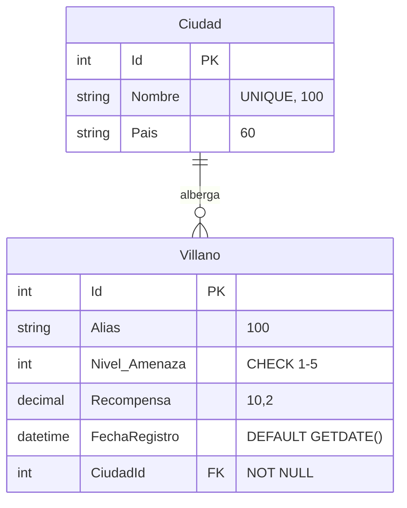
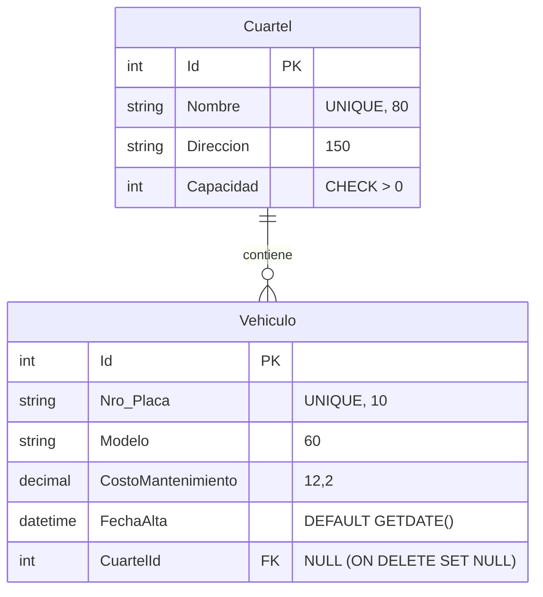

# CLASE 02 – PRÁCTICA DE FLUENT API CON ARCHIVOS DE CONFIGURACIÓN

En este proyecto se implementó la práctica completa solicitada en la guía:
1. **Modelado y Fluent API con `IEntityTypeConfiguration<T>`**:
   - `Ciudad` y `Villano` (ejemplo guiado).
   - `Cuartel` y `Vehiculo` (ejercicio autónomo).
2. **Contexto `HeroesDbContext`**:
   - DbSets registrados.
   - Configuraciones aplicadas mediante `modelBuilder.ApplyConfiguration(...)`.
3. **Controlador `LaboratorioEfController`**:
   - `/LaboratorioEf/Ciudad/{id}`
   - `/LaboratorioEf/ModeloVillano`
   - `/LaboratorioEf/Cuartel/{id}`
4. **Respuestas a las preguntas**:
   - Ubicadas en `respuestas_preguntas.txt`.

---

## 1. Diagrama Entidad-Relación (DER)

### A. Ciudad y Villano


### B. Cuartel y Vehículo (Ejercicio)


---

## 2. Scripts SQL para la Base de Datos (`HeroesClase1`)

Se incluye el script completo en `HeroesClase1_Script.sql` para crear las tablas e insertar los datos de prueba en caso de querer ejecutarlos en SQL Server:

```sql
USE master;
GO
IF NOT EXISTS (SELECT name FROM sys.databases WHERE name = N'HeroesClase1')
BEGIN
    CREATE DATABASE HeroesClase1;
END
GO
USE HeroesClase1;
GO

-- 1. Tablas Ciudad y Villano
IF OBJECT_ID('dbo.Villanos', 'U') IS NOT NULL DROP TABLE dbo.Villanos;
IF OBJECT_ID('dbo.Ciudades', 'U') IS NOT NULL DROP TABLE dbo.Ciudades;

CREATE TABLE dbo.Ciudades (
    Id INT IDENTITY(1,1) NOT NULL PRIMARY KEY,
    Nombre NVARCHAR(100) NOT NULL,
    Pais NVARCHAR(60) NOT NULL,
    CONSTRAINT UQ_Ciudades_Nombre UNIQUE (Nombre)
);
GO

CREATE TABLE dbo.Villanos (
    Id INT IDENTITY(1,1) NOT NULL PRIMARY KEY,
    Alias NVARCHAR(100) NOT NULL,
    Nivel_Amenaza INT NOT NULL,
    Recompensa DECIMAL(10,2) NOT NULL,
    FechaRegistro DATETIME NOT NULL CONSTRAINT DF_Villanos_FechaRegistro DEFAULT (GETDATE()),
    CiudadId INT NOT NULL,
    CONSTRAINT CK_Villanos_NivelAmenaza CHECK ([Nivel_Amenaza] BETWEEN 1 AND 5),
    CONSTRAINT FK_Villanos_Ciudades FOREIGN KEY (CiudadId) REFERENCES dbo.Ciudades(Id)
);
GO

-- 2. Tablas Cuarteles y Vehiculos
IF OBJECT_ID('dbo.Vehiculos', 'U') IS NOT NULL DROP TABLE dbo.Vehiculos;
IF OBJECT_ID('dbo.Cuarteles', 'U') IS NOT NULL DROP TABLE dbo.Cuarteles;

CREATE TABLE dbo.Cuarteles (
    Id INT IDENTITY(1,1) NOT NULL PRIMARY KEY,
    Nombre NVARCHAR(80) NOT NULL,
    Direccion NVARCHAR(150) NOT NULL,
    Capacidad INT NOT NULL,
    CONSTRAINT UQ_Cuarteles_Nombre UNIQUE (Nombre),
    CONSTRAINT CK_Cuarteles_Capacidad CHECK (Capacidad > 0)
);
GO

CREATE TABLE dbo.Vehiculos (
    Id INT IDENTITY(1,1) NOT NULL PRIMARY KEY,
    Nro_Placa NVARCHAR(10) NOT NULL,
    Modelo NVARCHAR(60) NOT NULL,
    CostoMantenimiento DECIMAL(12,2) NOT NULL,
    FechaAlta DATETIME2 NOT NULL CONSTRAINT DF_Vehiculos_FechaAlta DEFAULT (GETDATE()),
    CuartelId INT NULL,
    CONSTRAINT UQ_Vehiculos_Placa UNIQUE (Nro_Placa),
    CONSTRAINT FK_Vehiculos_Cuarteles FOREIGN KEY (CuartelId) REFERENCES dbo.Cuarteles(Id) ON DELETE SET NULL
);
GO

-- Inserción de datos de prueba
INSERT INTO dbo.Ciudades (Nombre, Pais) VALUES (N'La Paz', N'Bolivia'), (N'Santa Cruz', N'Bolivia');
DECLARE @LaPaz INT = (SELECT Id FROM dbo.Ciudades WHERE Nombre = N'La Paz');
INSERT INTO dbo.Villanos (Alias, Nivel_Amenaza, Recompensa, CiudadId)
VALUES (N'Sombra Roja', 4, 15000.00, @LaPaz),
       (N'Doctor Niebla', 3, 8500.50, @LaPaz);

INSERT INTO dbo.Cuarteles (Nombre, Direccion, Capacidad)
VALUES (N'Base Illimani', N'Av. Arce 123, La Paz', 20),
       (N'Base Oriente', N'Calle Sucre 45, Santa Cruz', 12);

DECLARE @Illimani INT = (SELECT Id FROM dbo.Cuarteles WHERE Nombre = N'Base Illimani');
INSERT INTO dbo.Vehiculos (Nro_Placa, Modelo, CostoMantenimiento, CuartelId)
VALUES (N'2345-ABC', N'Halcón X1', 8500.00, @Illimani),
       (N'9876-XYZ', N'Rayo T2', 4200.75, @Illimani),
       (N'1111-DEF', N'Tortuga M3', 1500.00, NULL);
GO
```

---

## 3. Pruebas de SQL en SSMS (Transacciones y Validaciones)

```sql
-- D1. Nombre de ciudad repetido (Falla por UQ_Ciudades_Nombre)
BEGIN TRY
    BEGIN TRANSACTION;
    INSERT INTO dbo.Ciudades (Nombre, Pais) VALUES (N'La Paz', N'Bolivia');
    ROLLBACK TRANSACTION;
END TRY
BEGIN CATCH
    IF @@TRANCOUNT > 0 ROLLBACK TRANSACTION;
    SELECT ERROR_MESSAGE() AS Resultado;
END CATCH;

-- D2. Nivel fuera de rango (Falla por CK_Villanos_NivelAmenaza)
BEGIN TRY
    BEGIN TRANSACTION;
    UPDATE dbo.Villanos SET Nivel_Amenaza = 9
    WHERE Id = (SELECT MIN(Id) FROM dbo.Villanos);
    ROLLBACK TRANSACTION;
END TRY
BEGIN CATCH
    IF @@TRANCOUNT > 0 ROLLBACK TRANSACTION;
    SELECT ERROR_MESSAGE() AS Resultado;
END CATCH;

-- D3. Borrar ciudad con villanos (Falla por FK_Villanos_Ciudades)
BEGIN TRY
    BEGIN TRANSACTION;
    DELETE FROM dbo.Ciudades WHERE Nombre = N'La Paz';
    ROLLBACK TRANSACTION;
END TRY
BEGIN CATCH
    IF @@TRANCOUNT > 0 ROLLBACK TRANSACTION;
    SELECT ERROR_MESSAGE() AS Resultado;
END CATCH;

-- D4. Ejercicio Cuarteles: Borrar cuartel deja vehículos con CuartelId = NULL
BEGIN TRANSACTION;
DECLARE @Id INT = (SELECT Id FROM dbo.Cuarteles WHERE Nombre = N'Base Illimani');
DELETE FROM dbo.Cuarteles WHERE Id = @Id;
SELECT Nro_Placa, Modelo, CuartelId FROM dbo.Vehiculos;
ROLLBACK TRANSACTION;
```
